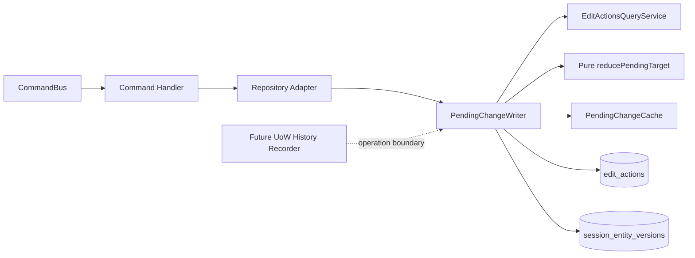

<!--
 Copyright (c) Qualcomm Technologies, Inc. and/or its subsidiaries.
 SPDX-License-Identifier: BSD-3-Clause
-->

# Current Pending-State Implementation Design

**Requirements:** [`../current-state-and-future-undo-requirements.md`](../current-state-and-future-undo-requirements.md)

**Date:** 2026-10-13
**Status:** Draft — awaiting written-spec review

---

## 1. Decision

Keep `edit_actions` as the relational current pending-state table and replace its history-oriented behavior with a centralized, target-scoped current-state reducer.

The selected design has these properties:

- `edit_actions` contains only current uncommitted state;
- `validUntil` and persisted `groupId` are removed;
- one field value is stored by at most one field storage slot;
- exact-slot mutations update in place and preserve `changeId`;
- session-created targets remain one complete CREATE row;
- target-wide lifecycle transitions are reduced by one pure function;
- immediate and cached writes use the same reducer;
- committed optimistic-concurrency baselines remain separate;
- future undo/redo records operations and target snapshots outside `edit_actions`.

This is not event sourcing. Canonical project tables remain unchanged until commit, and the current overlay never reads future history tables.

---

## 2. Scope

### 2.1 Included

- `edit_actions` schema and current-row constraints;
- `session_entity_versions` target identity correction;
- `PendingChangeWriter` refactoring;
- a pure target-state reducer coordinated by `PendingChangeWriter`;
- target-aware cached mutations and automatic UoW flush;
- current-state query and overlay simplification;
- session cleanup through the centralized mutation boundary;
- affected persistence and UoW tests;
- compatibility seam for future operation/memento recording.

### 2.2 Excluded

- backend Undo/Redo implementation;
- `edit_history_operations` or `edit_history_target_states` tables now;
- currently stubbed Stage, Unstage, Commit, and Discard endpoint delivery;
- DiffMerge comparer or stager implementation;
- element-path mutation/reduction, which remains owned by its dedicated LLD;
- API idempotency;
- mutable-row optimistic revision columns;
- conversion of active historical edit-action chains.

Stage, discard, and commit sections below define compatibility semantics for the current projection. They do not bring the corresponding stubbed endpoints into this implementation scope.

`FR-CS-19` remains a frozen current-release requirement, but its enforcement belongs to delivery of the DiffMerge apply command rather than this pending-state refactor. Section 11.4 defines the compatibility rule this design must preserve; this implementation does not claim to deliver that command or its durable session marker.

---

## 3. Terminology

| Term | Meaning |
|---|---|
| Target key | `(sessionId, targetTable, targetSystemId)` |
| Field storage slot | One current `edit_actions` row whose `fieldPath` and payload store one or more current pending field values |
| Exact-slot mutation | Mutation of the same target and logical field storage slot |
| Session-created target | Target represented by one current CREATE and absent from committed storage |
| Committed target | Target that exists in canonical storage and may have pending UPDATE or DELETE state |
| Cancellation | Removal of a session-created target's CREATE before commit |
| Current projection | All current `edit_actions` rows used by overlay, validation, staging, and commit |
| Command correlation ID | UUID generated once per write API call and optionally returned as `groupId`; not persisted in `edit_actions` |

`source` has operation-specific semantics:

- CREATE: origin of the pending target;
- UPDATE: writer that most recently modified the atomic slot;
- DELETE: initiator of the current deletion.

---

## 4. Architecture



### 4.1 Package boundaries

- Core handlers and repository ports remain domain-oriented.
- Core imports no TypeORM, NestJS, or Node APIs.
- Persistence repository adapters continue translating domain writes into pending mutations.
- The reducer is a plain TypeScript function inside the persistence package and imports no TypeORM classes.
- `PendingChangeWriter` reuses `EditActionsQueryService` and keeps straightforward TypeORM execution in private methods.
- Handlers continue owning transaction start, commit, and rollback.

### 4.2 Components

#### `PendingChangeWriter`

The sole mutation facade used by persistence repositories. It coordinates target loading through `EditActionsQueryService`, pure reduction, and plan execution through private methods. Repositories shall not write `edit_actions` directly.

Conceptual public methods are:

```typescript
writeCreate(spec, sessionId, manager)
writeDelta(spec, sessionId, manager)
writeDeltaBatch(specs, sessionId, manager)
writeDelete(spec, sessionId, manager)
wipeUnstagedForSession(sessionId, manager)
deleteBySource(sessionId, source, manager)
```

The two bulk-cleanup methods are intentionally explicit rather than one generic
delete API. Session-end cleanup removes both remaining UNSTAGED current rows and
the session's committed-target baselines. Source cleanup removes current rows for
the requested source only and must not clear baselines, because another current
or future mutation in the same session may still rely on capture-once protection.

The command correlation UUID is not an argument because it is not current-row data.

#### `reducePendingTarget`

A pure module-level function that receives one complete target snapshot and one or more mutation intents, then returns an executable plan. It owns lifecycle classification, field-storage resolution, and metadata policy. It is not an injected class or service.

Its input and output contracts remain internal to the reducer and writer. They may be co-located with the reducer unless a second real consumer requires a shared module.

#### `PendingChangeCache`

Remains a data-only UoW buffer. It stores ordered mutation intents by target and contains no loading, reduction, or persistence policy.

### 4.3 Above-persistence impact

Handlers and domain services keep their behavior. Repository implementation changes are mechanical where they stop forwarding `groupId` and route direct pending-state cleanup through the writer. Existing write responses may continue returning the command correlation UUID.

`ISessionRepository` retains `wipeUnstagedForSession(sessionId)` and `deleteEditActionsBySource(sessionId, source)` as port-level methods with unchanged signatures, because `EndSessionHandler` and `AutoRoutingPreparationService` in core call them and core cannot import persistence-layer classes. The TypeORM implementations of these two methods change to delegate to `PendingChangeWriter.wipeUnstagedForSession` and `PendingChangeWriter.deleteBySource` respectively, rather than executing raw SQL directly. `ISessionRepository.deleteEditActionsByChangeIds` is not rerouted — its raw SQL implementation and port signature are both unchanged (see §11.3).

---

## 5. Persistence Model

### 5.1 `edit_actions`

Keep the existing table name. Define it explicitly as current uncommitted edit state, not an append-only action history.

| Column | Null | Meaning |
|---|---:|---|
| `change_id` | no | Stable generated identity of one logical current slot |
| `session_id` | no | Owning session; FK with cascade cleanup |
| `aggregate_id` | no | Aggregate read scope |
| `target_table` | no | Canonical `ENTITY_NAMES` target |
| `target_system_id` | no | Target row ID |
| `operation` | no | Persisted CREATE, UPDATE, or DELETE |
| `field_path` | yes | `$`, null accumulator, scalar, group, or element slot |
| `new_value` | no | Complete current payload for the slot |
| `source` | no | Current closed `SOURCE` enum from core: MANUAL, DIFF_TOOL, or AUTO_ROUTING |
| `change_status` | no | STAGED or UNSTAGED |
| `linked_entity_group_id` | yes | Explicit linked selection/dependency group |
| `created_at` | no | Time the logical slot was created |

Remove:

- `valid_until`;
- `group_id`.

`change_id` remains `INTEGER PRIMARY KEY AUTOINCREMENT`. Exact-slot mutations use UPDATE and preserve it. Removed identifiers are not reused for unrelated slots.

Persisted operation constraints permit only CREATE, UPDATE, and DELETE. `NONE` remains a read-model value.

The core `SOURCE` vocabulary is authoritative. Normal user writes default to MANUAL; the future diff stager passes DIFF_TOOL explicitly; routing writers pass AUTO_ROUTING explicitly. The TypeORM simple-enum constraint mirrors exactly those values. Unknown values are rejected rather than stored, and no legacy-source conversion is needed because deployment begins without pending rows.

### 5.2 Slot uniqueness

SQLite requires separate indexes for null and non-null paths:

```text
UNIQUE(session_id, target_table, target_system_id, field_path)
WHERE field_path IS NOT NULL

UNIQUE(session_id, target_table, target_system_id)
WHERE field_path IS NULL
```

Add ordinary indexes for:

- `(session_id, aggregate_id)`;
- `(session_id, target_table, target_system_id)`;
- `(session_id, source)`;
- `(session_id, change_status)`;
- `(session_id, linked_entity_group_id)` when linked ID is non-null.

Cross-slot overlap cannot be represented safely as a SQLite constraint. The reducer prevents it, and overlay reports stored violations as integrity failures.

### 5.3 `session_entity_versions`

Use the complete target identity:

```text
PRIMARY KEY(session_id, target_table, target_system_id)
```

with `base_version`.

A current CREATE proves session-created origin, so no ABSENT baseline marker is required. Baselines are captured only for committed targets and survive exact-slot replacement, discard, and UPDATE-to-DELETE transitions until successful commit or session end.

Baseline capture is insert-if-absent on the complete target key and never updates an existing row. If a baseline already exists, that original value remains authoritative even when the canonical version has since changed; the mutation may continue, and commit detects the mismatch against that original baseline. A constraint or read failure is an error rather than a reason to recapture.

### 5.4 Command correlation

`CommandBus` continues generating one UUID per write API call. Internal subcommands reuse the parent operation context. The UUID may remain in response DTOs as `groupId` and in structured logs, but current query, overlay, staging, and commit do not persist or select by it.

---

## 6. Reducer Contract

Conceptual input and output:

```typescript
type PendingTargetSnapshot = {
  target: TargetKey;
  committed: {exists: boolean; version?: number};
  rows: readonly EditActionRow[];
};

type PendingMutationPlan = {
  updates: readonly StableRowUpdate[];
  inserts: readonly NewRowInsert[];
  deleteChangeIds: readonly number[];
  deleteWholeTarget: boolean;
  captureBaseline?: {target: TargetKey; baseVersion: number};
};

reducePendingTarget(
  snapshot: PendingTargetSnapshot,
  intents: readonly PendingMutationIntent[],
): PendingMutationPlan
```

These are internal conceptual shapes, not public persistence contracts. The reducer performs no SQL and does not allocate database IDs. It validates the entire requested mutation sequence before returning one consolidated plan.

Concrete definitions for every named type:

```typescript
type TargetKey = {
  sessionId: number;
  targetTable: EntityName;    // ENTITY_NAMES constant from @arc/core
  targetSystemId: number;
};

// Three intent variants — one per mutation kind

type CreateIntent = {
  kind: 'CREATE';
  aggregateId: number;
  source: Source;
  changeStatus: PendingChangeStatus;
  linkedEntityGroupId: number | null;
  newValue: Record<string, unknown>;
};

type UpdateIntent = {
  kind: 'UPDATE';
  aggregateId: number;
  /** null = accumulator; '$' = whole-row; scalar name or named group otherwise */
  fieldPath: string | null;
  source: Source;
  /**
   * Used only when the reducer inserts a new row for this fieldPath.
   * When the fieldPath already has a current row, the existing changeStatus is preserved.
   */
  changeStatus: PendingChangeStatus;
  /**
   * Used only when the reducer inserts a new row.
   * When the fieldPath already has a current row, the existing linkedEntityGroupId is preserved.
   */
  linkedEntityGroupId: number | null;
  newValue: Record<string, unknown>;
};

type DeleteIntent = {
  kind: 'DELETE';
  aggregateId: number;
  source: Source;
  changeStatus: PendingChangeStatus;
  linkedEntityGroupId: number | null;
};

type PendingMutationIntent = CreateIntent | UpdateIntent | DeleteIntent;

// Plan output: the writer executes exactly these operations after the reducer returns

type StableRowUpdate = {
  changeId: number;                   // identifies the existing row to UPDATE in place
  newValue: Record<string, unknown>;  // replacement payload
  source: Source;                     // new source for UPDATE slots; CREATE slot source is preserved
};

type NewRowInsert = {
  aggregateId: number;
  operation: ChangeOperation;         // CREATE | UPDATE | DELETE  (ChangeOperation from @arc/core)
  fieldPath: string | null;
  newValue: Record<string, unknown>;
  source: Source;
  changeStatus: PendingChangeStatus;
  linkedEntityGroupId: number | null;
  // changeId: AUTOINCREMENT — not supplied by caller
  // sessionId, targetTable, targetSystemId: taken from TargetKey — not duplicated here
};
```

### 6.1 Target states

| State | Stored shape |
|---|---|
| `ABSENT` | No committed row and no pending row |
| `COMMITTED_CLEAN` | Committed row, no pending row |
| `SESSION_CREATED` | One current CREATE |
| `COMMITTED_UPDATED` | Committed row plus one or more disjoint UPDATE slots |
| `COMMITTED_DELETED` | Committed row plus one DELETE |

Any other lifecycle combination is a stored-state integrity failure.

These state names document the transition model; they are not persisted and do not require an exported enum or materialized discriminated union. The reducer may use direct guard clauses over committed existence and the counts of CREATE, UPDATE, and DELETE rows. A private classifier is justified only if it makes those guards easier to understand.

### 6.2 Transition matrix

| Current state | Mutation | Result |
|---|---|---|
| `ABSENT` | CREATE | Insert one CREATE |
| `ABSENT` | UPDATE/DELETE | Not found |
| `COMMITTED_CLEAN` | UPDATE | Capture baseline; insert declared slots |
| `COMMITTED_CLEAN` | DELETE | Capture baseline; insert DELETE |
| `SESSION_CREATED` | UPDATE | Update CREATE payload in place |
| `SESSION_CREATED` | DELETE | Remove CREATE; target becomes absent |
| `SESSION_CREATED` | CREATE | Duplicate conflict |
| `COMMITTED_UPDATED` | UPDATE | Update existing storage slots and add valid new slots atomically |
| `COMMITTED_UPDATED` | DELETE | Remove UPDATE slots; insert one DELETE |
| `COMMITTED_DELETED` | Mutation using old ID | Reject; no implicit resurrection |

A user may create a replacement entity only through normal CREATE allocation with a new system ID.

---

## 7. Field Storage Resolution

### 7.1 Slot forms

| `fieldPath` | Storage coverage |
|---|---|
| `null` | Normal DESIGNER accumulator; covers keys present in its payload and may expand with normal Designer fields |
| `$` CREATE | Complete session-created target payload |
| `$` UPDATE | Explicit whole-row replacement payload |
| scalar name | One field |
| named group | Fixed atomic fields represented by its payload |
| element path | One addressed structured element when element mutation is implemented |

One field may be stored by only one current slot. Named group membership changes require an explicit regrouping operation. A normal mutation cannot create an overlapping scalar, group, accumulator, or whole-row value.

Element-path syntax remains reserved by the storage contract, but this implementation does not add element-tree navigation or mutation. The reducer rejects element-path mutation intents with a typed unsupported-operation error. When that dedicated implementation is added, it must use the same reducer boundary and must not overlap a parent whole-row/group value for the same logical element.

### 7.2 Multi-field algorithm

For one request:

1. determine the storage slot covering each changed field;
2. collect changed fields by distinct existing slot;
3. update every existing slot once;
4. add unrepresented fields at the granularity declared by the operation;
5. allow an existing null DESIGNER accumulator to expand with unrepresented normal fields;
6. reject implicit named-group expansion, overlap, or ambiguous storage;
7. execute the complete plan atomically.

### 7.3 Examples

#### Existing accumulator

```text
Before changeId=10, fieldPath=null:
  {alias: "A", maxInputPorts: 2}

Request:
  {alias: "B", maxInputPorts: 4}

After changeId=10:
  {alias: "B", maxInputPorts: 4}
```

The row is updated once.

#### Accumulator expansion

```text
Before changeId=10, fieldPath=null:
  {alias: "A"}

Later DESIGNER request:
  {containerSystemId: 8}

After changeId=10:
  {alias: "A", containerSystemId: 8}
```

No second null slot is created.

#### Independent slots

```text
changeId=21, fieldPath="alias",             status=UNSTAGED
changeId=22, fieldPath="containerSystemId", status=STAGED
```

A request changing both updates each stable row once. Each keeps its own status.

#### Atomic named group

```text
changeId=30
fieldPath="portLimits"
payload={maxInputPorts: 2, maxOutputPorts: 2}
```

Changing only `maxInputPorts` updates row 30 to `{4, 2}`. The group remains one selection unit.

#### Existing plus new scalar

An existing `alias` scalar is updated in place while an unrepresented `maxOutputPorts` field receives a new scalar slot. Both mutations commit together.

#### Overlap rejection

If `alias` already has a scalar slot, a normal write cannot create a new `identityGroup` containing `alias`. An explicit regrouping operation is required.

---

## 8. Metadata Policy

### 8.1 Exact-slot value mutation

| Metadata | CREATE | UPDATE |
|---|---|---|
| `changeId` | preserve | preserve |
| `operation` | remain CREATE | remain UPDATE |
| `source` | preserve origin | set to current writer |
| `changeStatus` | preserve | preserve |
| `linkedEntityGroupId` | preserve | preserve |
| `aggregateId` | preserve | preserve |

A composite UPDATE changing one member becomes MANUAL when written by a user. That source means the atomic slot's latest writer, not independent provenance for every member.

### 8.2 New slot

Allocate a new `changeId` and use source, initial status, aggregate scope, and linked group declared by the operation. Diff-tool status may be configured STAGED or UNSTAGED; storage does not hard-code that product default. A new manual slot starts STAGED.

### 8.3 Explicit metadata operations

- Stage/unstage changes only status.
- An explicit linked-group membership operation may set, replace, or clear `linkedEntityGroupId` while preserving `changeId`.
- Ordinary value mutation never changes linked-group membership.

### 8.4 DELETE transition

A committed-target DELETE removes all UPDATE slots and creates one new target-wide DELETE with a new `changeId` and the DELETE operation's source, status, and explicit linked-group metadata. It does not inherit row metadata from removed UPDATEs. The target baseline remains unchanged.

### 8.5 Cascades and derived mutations

Domain services remain responsible for selecting the complete cascade: roots, owned rows, relationships, and derived survivor updates. They submit that complete mutation set through repository adapters in one handler-owned transaction.

Persistence classifies and reduces every selected target independently. One cascade may therefore cancel a session-created target, create a real DELETE for a committed target, and update a committed survivor. Failure of any target rolls back the complete command.

High-fan-out cascades group target keys by table, load current rows and baselines in bounded chunks, reduce targets in memory, and execute set-based updates/deletes/inserts. They must not issue one historical lookup per action.

---

## 9. Execution, Cache, and UoW

### 9.1 Immediate path

1. load all target rows;
2. load committed existence/version if origin is unsettled;
3. pass the loaded snapshot and ordered mutation list to the reducer;
4. capture required baseline with insert-ignore semantics;
5. update stable rows;
6. delete cancelled/replaced rows;
7. insert new rows;
8. return after plan execution; the surrounding handler owns transaction completion.

An expected stable row that disappears before execution produces a conflict and rolls back the command.

Committed existence/version loading (step 2) is a private writer helper. It queries the canonical target table via the injected `EntityManager`, dispatching on `targetTable` to select the right TypeORM entity — the same dispatch mechanism used by the existing `captureBaseVersion` helper. CREATE intents require confirmed absence; UPDATE and DELETE intents require confirmed existence plus the current entity version for baseline capture.

### 9.2 Cached path

Replace the append-only cache array with:

```text
Map<string, {targetKey: TargetKey; intents: PendingMutationIntent[]}>
```

Target keys are grouped by the values of `sessionId`, `targetTable`, and `targetSystemId`; use the canonical string `${sessionId}|${targetTable}|${targetSystemId}` as the JavaScript `Map` key to obtain value equality. Pipe separators avoid collision with valid values in each component. The same format is used by `EditActionsQueryService.getAllByTargetKeys` to key its return map, so cache and query service results align without conversion.

Flush behavior:

1. collect unique targets;
2. batch-load current target rows;
3. batch-load committed existence/version where required;
4. pass each snapshot and its ordered intents to the same reducer used by immediate writes;
5. batch capture baselines;
6. execute stable updates, deletions, and inserts in bounded chunks;
7. clear successful buffer entries.

The reducer accepts an ordered intent list in both cases: an immediate write supplies a one-item list, while a cached flush supplies the buffered list. The reducer owns any sequential in-memory transition needed to produce one consolidated plan, so loading time does not create a second mutation implementation.

Per-target intent order is the order in which `PendingChangeWriter` accepts the mutations. A batch appends intents in input-array order, and later calls append after earlier accepted calls. Callers that derive multiple mutations for the same target must provide their intended order rather than invoke those same-target writes concurrently. Distinct targets may be prepared concurrently because their reduction order has no semantic effect; plan execution still uses deterministic target-key order.

The cache does not reduce during enqueue because it does not yet know persisted CREATE, UPDATE, DELETE, metadata, or baseline state. Loading on first enqueue would introduce one query per target; requiring callers to preload targets would add a preparation protocol. Deferring reduction permits one bounded batch load without duplicating policy.

This removes the earlier restriction that disallowed `cache: true` for accumulator writes (`fieldGroup` omitted). That restriction existed only because the previous append-only cache could not fold accumulator payloads correctly. The batched reducer flush above resolves accumulator payloads the same way the immediate path does, so accumulator-mode writes may now be cached.

The same bounded, set-based strategy applies to linked-group status/discard operations and target-wide session cleanup.

### 9.3 Mixed writes

Once a target has buffered intents, later mutations for that target join the same buffer until flush. An immediate SQL path must never bypass unflushed state for that target.

### 9.4 Commit boundary

`TypeOrmUnitOfWork.commit()` performs an idempotent cache flush before `QueryRunner.commitTransaction()`. Existing explicit `applyCachedActions()` calls remain compatible, but correctness no longer depends on handlers remembering them.

---

## 10. Queries and Overlay

### 10.1 Query service

Keep `EditActionsQueryService` but make it current-state only.

**Remove:**

- `getHistoryByGroupId` — references `group_id`; no longer stored
- `getHistoryByAggregateIds` — history query; no longer needed
- the `validUntil IS NULL` predicate inside `applyOptions` — all rows are current rows after the redesign, no filtering required
- the `groupId` filter option from `QueryOptions` and `applyOptions`

**Add:**

- `getAllByTargetKey(targetKey: TargetKey, manager: EntityManager): Promise<EditActionRow[]>` — loads all current rows for one `(sessionId, targetTable, targetSystemId)` triple; used by the writer's immediate path step 1
- `getAllByTargetKeys(targetKeys: TargetKey[], manager: EntityManager): Promise<Map<string, EditActionRow[]>>` — batch-loads rows for all supplied target keys and returns results keyed by the canonical `${sessionId}|${targetTable}|${targetSystemId}` string; used by the cached flush step 2

**Retain unchanged:** `query`, `getByAggregateId`, `getByAggregateAndTable`, `getByTable`, `getBySource`, `findCurrentRow`, `findActiveSession`, `baseQb`, and `applyOptions` (with only the `validUntil`/`groupId` filter removals above applied).

### 10.2 Overlay shapes

| Pending shape | Effective result |
|---|---|
| No rows | Committed row |
| One CREATE | CREATE payload |
| Disjoint UPDATE slots | Committed row plus current slot values |
| One DELETE | Target absent |
| Conflicting shape or overlap | Typed integrity failure |

Because field storage does not overlap, application chronology cannot change field values. A deterministic row order may remain for stable DTO output, but it is not last-write conflict resolution.

Both STAGED and UNSTAGED rows participate. Display status is derived as STAGED, UNSTAGED, or PARTIAL from all current rows.

---

## 11. Stage, Discard, and Session Lifecycle

### 11.1 Stage/unstage

Selectors are current `changeId` values and explicit `linkedEntityGroupId` values. Command `groupId` is not a selector.

Status mutation updates rows in place. Selecting a member of a linked atomic group expands to all current group members before mutation.

### 11.2 Discard

| Action | Discard result |
|---|---|
| CREATE | Remove CREATE; target becomes absent |
| UPDATE | Remove selected field storage slot |
| DELETE | Remove tombstone; committed target becomes visible |
| Linked group | Apply corresponding discard to every member atomically |

Discard does not remove the committed target baseline. Capture-once protection remains until successful commit or session end.

### 11.3 Session end

1. reject if any STAGED row remains;
2. transactionally remove all UNSTAGED rows and session baselines;
3. delete a session with no commits;
4. otherwise retain it in ENDED state as commit audit metadata;
5. roll back the whole end-session attempt on failure.

Cleanup goes through `PendingChangeWriter` rather than repository-local direct SQL.

Session-end cleanup is a required current-state behavior, not only a future undo seam. The current no-commit path can rely on `project_sessions` foreign-key cascade after deleting the session row, but the committed-session path retains the session as ENDED. Therefore this implementation must explicitly remove remaining `session_entity_versions` rows during session-end cleanup before retaining an ENDED session.

Auto-routing preparation also routes its source-scoped cleanup through the same writer boundary. That cleanup deletes existing rows for the routing source before recomputation, but it does not delete baselines.

The existing stale-manual-usecase cleanup by `changeId` remains a narrow implementation detail for its current caller. A generic discard-by-`changeId` primitive is deferred until the Discard endpoint is designed and delivered, because this implementation does not define Discard's final selector expansion, linked-group handling, or validation rules.

### 11.4 Single DiffMerge application compatibility

Diff application is outside this implementation scope, so this refactor does not infer application state from `edit_actions` rows. When the DiffMerge apply command is delivered, it must persist durable session-level “diff applied” state in the same transaction as the complete apply. A failure rolls back both the marker and all pending mutations; only a successful transaction consumes the session's one apply. A later apply in that session is rejected, and recomputation requires a fresh session.

---

## 12. Commit Semantics

Commit applies only current STAGED rows.

### 12.1 Session-created target

One complete CREATE is inserted once, then removed from pending state. An UNSTAGED CREATE remains pending. Related target rows are committed in dependency-safe order.

### 12.2 Committed UPDATE target

1. compare committed version with target baseline;
2. apply staged disjoint slots;
3. increment committed version;
4. remove applied slots;
5. retain unstaged slots;
6. if rows remain, rebase the target baseline to the new committed version only after the canonical update succeeds;
7. otherwise remove its baseline.

Disjoint storage makes partial commit stable: committing one slot cannot reveal an older overlapping value. Pending replacement, discard, rollback, and failed commit never rewrite the capture-once baseline.

### 12.3 Committed DELETE target

Require the DELETE to be STAGED, verify the target baseline, delete in dependency-safe order, and remove the DELETE and baseline.

### 12.4 Failure

A conflict or execution error rolls back canonical writes, pending cleanup, baseline changes, and commit metadata. Pending work remains retryable.

---

## 13. Concurrency, Errors, and Logging

### 13.1 Current concurrency choice

No `row_revision` is added now. Stable-row writes use transaction isolation and unique slot constraints. Concurrent writes to the same mutable slot are last-write-wins at the current product scope.

The current implementation has no separate application-level per-item lock. This redesign preserves the database-enforced single ACTIVE session per file, handler-owned transactions, SQLite write serialization, capture-once committed baselines, and canonical entity-version conflict checks. Immediate and cached paths use those same mechanisms and cannot bypass them.

Multi-target plans process target keys in deterministic `(targetTable, targetSystemId)` order before bounded execution. Database busy/constraint failures are translated and roll back the complete command; no in-process mutex is introduced.

Add an optimistic row revision later if collaborative writers, demonstrated lost updates, or multi-instance stale-write rejection becomes a concrete requirement. API idempotency remains a separate duplicate-delivery concern.

### 13.2 Error mapping

| Condition | Outcome |
|---|---|
| Missing effective target | Existing not-found result |
| Duplicate CREATE | Conflict |
| Mutation against pending DELETE | Conflict/not-found by API convention |
| Requested overlap or implicit regroup | Conflict |
| Corrupt stored overlap/lifecycle shape | Internal integrity error |
| Committed baseline mismatch | Commit conflict |
| SQL/cache failure | Rollback and translated infrastructure error |

Never expose raw SQLite constraint text.

### 13.3 Logging

Use structured `Logger` calls. Include action, component, tag, timestamp, target table, and target system ID in hexadecimal. Do not log complete `newValue` payloads.

---

## 14. Future Undo/Redo Seam

The current release adds no history tables. A future release may wrap the authoritative `PendingChangeWriter` boundary with a UoW-scoped recorder and add `edit_history_operations` plus `edit_history_target_states`. The recorder, not the reducer or current rows, owns operation grouping and atomic before/after target snapshots.

This design preserves that seam by centralizing projection mutation and keeping committed baselines independent. Normal overlay, validation, staging, and commit never read future history tables.

Session-end cleanup and auto-routing source cleanup are included in the centralized writer boundary now because they are real current mutation paths and because future operation recording must observe their before/after projection effects. The stale-manual-usecase `changeId` cleanup remains outside the generic discard model until Discard is implemented.

Strict-LIFO cursor behavior, redo invalidation, session revision checks, routing and cascade grouping, deployment constraints, and history cleanup belong to the dedicated [future undo/redo implementation design](./future-undo-redo-implementation-design.md), not this current-state implementation.

---

## 15. Migration and Deployment

Deployment occurs only with projects read-only, no active edit sessions, and no pending actions. No history-chain conversion is required.

Schema workflow:

1. update `EditActionSchema` and `SessionEntityVersionSchema`;
2. update entity registration and query code;
3. build the repository;
4. delete the existing `initial-create` migration;
5. regenerate it with `pnpm run migration:gen .../initial-create`;
6. add the copyright header and type-only TypeORM import;
7. update `migration-index.ts`;
8. run schema integration tests against a clean database.

Do not hand-write migration SQL or edit generated `dist/` files.

---

## 16. Code Impact

### 16.1 Persistence schema and queries

```text
packages/infrastructure/persistence/src/persistence-typeorm-sqllite/
  entity-schema/edit-session/edit-action.schema.ts
  entity-schema/edit-session/session-entity-version.schema.ts
  queries/edit-session/edit-actions-query-service.ts
  queries/edit-session/overlay-merge.ts
  queries/edit-session/field-path-reducer.ts
  migration-index.ts
  migrations/<timestamp>-initial-create.ts
```

### 16.2 Mutation services

```text
packages/infrastructure/persistence/src/persistence-typeorm-sqllite/services/
  pending-change-writer.ts
  pending-change-cache.ts
  pending-target-reducer.ts              # new, pure function
```

`PendingChangeWriter` keeps target loading and plan execution private, reusing `EditActionsQueryService` rather than adding one-caller wrapper classes.

Move the current session-end UNSTAGED wipe and auto-routing source wipe behind writer-owned bulk-cleanup methods. Session-end cleanup also deletes remaining session baselines explicitly so the ENDED-session path does not rely on a foreign-key cascade that only runs when the session row is hard-deleted. Do not generalize the current stale-manual-usecase `changeId` delete into a public discard primitive in this implementation.

Remove the guard in the existing `PendingChangeWriter` that throws when `cache: true` is passed with a `fieldPath` of `null` (accumulator writes). That guard existed only because the old append-only cache could not fold accumulator payloads without an immediate read-modify-write. The new batched reducer flush handles accumulator intents correctly at flush time; the guard is dead code and must be deleted.

### 16.3 UoW and repositories

```text
packages/api/src/infrastructure-wrapper/persistence/unit-of-work/
  typeorm-unit-of-work.ts

packages/infrastructure/persistence/src/persistence-typeorm-sqllite/repositories/
  session/typeorm-session.repository.ts
  module/module.repository.ts
  subgraph/subgraph.repository.ts
  container/container.repository.ts
  subsystem/...
  data-link/...
  control-link/...
  usecase/...
```

Repository port contracts and command handlers remain unchanged except as noted below.

**`typeorm-session.repository.ts`**

- `wipeUnstagedForSession`: replace the raw SQL body with a call to `writer.wipeUnstagedForSession(sessionId, manager)`. Port signature unchanged.
- `deleteEditActionsBySource`: replace the raw SQL body with a call to `writer.deleteBySource(sessionId, source, manager)`. Port signature unchanged.
- `deleteEditActionsByChangeIds`: no change — raw SQL body stays; this method is not routed through the writer (see §11.3).

**All domain entity repositories** (`module.repository.ts`, `subgraph.repository.ts`, `container.repository.ts`, and the others listed above)

For every existing call through `PendingChangeWriter`:
- Remove the `groupId` field from every write spec argument — `PendingChangeWriter` no longer accepts or stores it.
- Remove any `validUntil`-related arguments or options passed to the writer.
- Remove any workaround that avoids passing `cache: true` for accumulator (`fieldPath = null`) writes — the guard is deleted (see §16.2 above).

No port-level or handler-level changes are required for these repositories.

---

## 17. Test Strategy

Use TDD for `reducePendingTarget` and update existing suites rather than duplicating repository coverage.

### 17.1 New focused unit tests

- transition matrix for every target state;
- stable `changeId` exact-slot mutation;
- CREATE absorption with origin source and status preservation;
- scalar, accumulator, whole-row, and named-group storage resolution;
- accumulator expansion;
- UPDATE source replacement;
- overlap and implicit-regroup rejection;
- CREATE cancellation and committed DELETE reduction;
- multi-field atomic plans;

### 17.2 Update existing tests

Revise current writer, cache, query, overlay, schema, repository, and UoW tests that assume:

- `validUntil` history;
- replacement `changeId` generation;
- persisted `groupId`;
- append-only cache rows;
- overlapping CREATE and UPDATE rows.

Primary existing suites include:

```text
packages/infrastructure/persistence/tests/unit/services/pending-change-writer.spec.ts
packages/infrastructure/persistence/tests/unit/services/pending-change-cache.spec.ts
packages/infrastructure/persistence/tests/unit/queries/edit-session/overlay-merge.spec.ts
packages/infrastructure/persistence/tests/integration/edit-session/
packages/infrastructure/persistence/tests/integration/queries/edit-session/
packages/infrastructure/persistence/tests/integration/repositories/
packages/api/tests/unit/infrastructure-wrapper/persistence/unit-of-work/
```

Add repository-specific scenarios only where behavior changes; existing suites remain the regression base.

Add one focused integration case proving that immediate and cached entry paths persist the same result. The reducer transition matrix is tested once rather than duplicated as an exhaustive cache-parity suite.

### 17.3 Acceptance cases

1. CREATE then repeated field edits leaves one stable CREATE row.
2. Manual edit of a DiffTool CREATE preserves CREATE source and status.
3. Manual exact-slot UPDATE changes source to MANUAL while preserving status and linked group.
4. DESIGNER accumulator expands without a second null slot.
5. Named-group member edit updates the group once.
6. Overlapping field storage is rejected.
7. CREATE then DELETE leaves no pending row or baseline.
8. Committed UPDATE then DELETE leaves one new DELETE and the original baseline.
9. Old-ID mutation against pending DELETE cannot resurrect the target.
10. Immediate and cached intent sequences produce identical state.
11. Command correlation UUID is returned but absent from `edit_actions`.
12. Failed commit or cache flush leaves pending state and baselines unchanged.
13. Session end removes remaining unstaged rows and baselines transactionally.
14. Ending a session that has prior commits still removes leftover baselines before retaining the session as ENDED.
15. Auto-routing source cleanup removes prior routing rows through the writer boundary without deleting baselines.

---

## 18. Alternatives Rejected

### SQL-centric repository rules

Direct upserts in each repository reduce initial file count but duplicate lifecycle and storage-coverage policy, let immediate and cached behavior drift, and provide no authoritative future recorder boundary.

### One JSON document per target

A target document simplifies whole-target replacement but makes per-slot `changeId`, status, source, linked selection, querying, and relational commit planning substantially harder.

### Retained `validUntil` history

Retaining superseded rows conflicts with the current-state requirement and couples normal reads to history that is not required until the separately deployed future undo feature.

### Persisted `groupId`

API-call membership belongs to future operation history, not mutable current rows. The current command UUID remains response/log correlation only.

### New `changeId` on every replacement

Rotating the public selection handle forces client refresh/remapping and treats a payload revision as a new logical slot. Stable identity better matches the current-state model.

### Reduction during cache enqueue

The cache cannot reduce correctly without the persisted target snapshot. Loading on each target's first enqueue introduces per-target queries, while mandatory preloading adds a caller-visible preparation protocol. Buffering ordered intents and reducing after one bounded batch load keeps the cache policy-free and preserves one reducer implementation.

---

## 19. Requirement Coverage

| Requirement area | Design sections |
|---|---|
| Current state, stable identity, no group/history | 1, 5, 8 |
| Field storage and multi-field mutation | 6, 7 |
| CREATE/UPDATE/DELETE lifecycle | 6, 8 |
| Overlay and validation | 10 |
| Baseline, commit, and rollback | 5.3, 12 |
| Stage, discard, and session cleanup | 11 |
| Central mutation and cached batching | 4, 9 |
| Single diff application compatibility, not command delivery | 2, 11.4 |
| Future operation/memento compatibility | 14 |
| Migration and verification | 15-17 |
